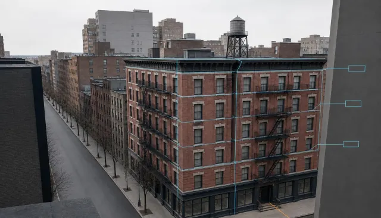
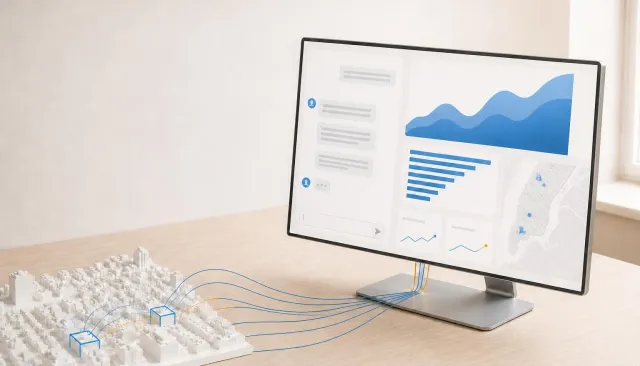
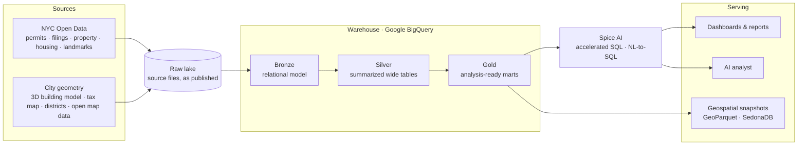
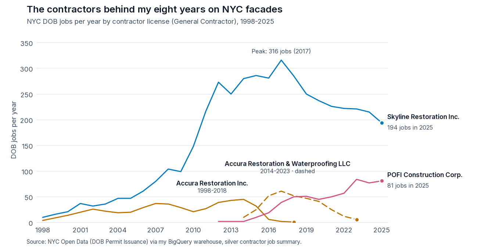

<picture>
  <source media="(prefers-color-scheme: dark)" srcset="assets/banner_dark.png">
  
</picture>

### Hi, I'm Maxwell Grant, founder of [Velabyte](https://velabyte.app)

I spent eight years on NYC high-rise exterior restoration and construction, on scaffolds and swing stages along the city's facades. Then I learned to build the data side of the industry I came from. **Velabyte** is the result: business intelligence for real estate firms, engineers, architects and construction trades, with ready-made analytics and process automation built on NYC's public building records.

  
  
  

---

## Velabyte

<picture>
  <source media="(prefers-color-scheme: dark)" srcset="assets/manhattan_dark.webp">
  
</picture>

The velabyte.app homepage is a live WebGPU render of real Manhattan footprints from the NYC 3D Building Model. Its scripted tour traces the Ladies' Mile Historic District and lifts the Flatiron Building's facades into a measured takeoff. (Recorded loop, 2× speed.)

### What it does

<table>
  <tr>
    <td width="33%" valign="top">
      <picture><source media="(prefers-color-scheme: dark)" srcset="assets/building_profile_dark.webp"></picture>
      <b>Building Profile</b> One view of any NYC building: permits and filings, property value and sales, housing and landmark records, and compliance history.
    </td>
    <td width="33%" valign="top">
      <picture><source media="(prefers-color-scheme: dark)" srcset="assets/facade_compliance_dark.webp"></picture>
      <b>Facade Compliance</b> Facade Inspection Safety Program (FISP) technical reports with building details, trends and geographic analysis.
    </td>
    <td width="33%" valign="top">
      <picture><source media="(prefers-color-scheme: dark)" srcset="assets/permit_issuance_dark.webp"></picture>
      <b>Permit Issuance</b> Permits issued to general contractors, master plumbers, fire suppression, oil burner and sign hanger companies, with trend and geographic analysis.
    </td>
  </tr>
  <tr>
    <td valign="top">
      <picture><source media="(prefers-color-scheme: dark)" srcset="assets/building_energy_dark.webp"></picture>
      <b>Building Energy Efficiency</b> Exploratory and geographic analysis for sustainability compliance under Local Law 95.
    </td>
    <td valign="top">
      <picture><source media="(prefers-color-scheme: dark)" srcset="assets/vela_analyst_dark.webp"></picture>
      <b>Vela Analyst</b> An AI assistant that analyzes every dataset from one workspace, for cross-dataset questions and market insight. In beta.
    </td>
    <td valign="top">
      <picture><source media="(prefers-color-scheme: dark)" srcset="assets/job_application_dark.webp"></picture>
      <b>Job Application</b> Engineering and architecture job filings with job details, trends and geographic analysis.
    </td>
  </tr>
</table>

### How it's built

**Data architecture**
- **Raw lake:** source files land untouched, exactly as the city publishes them, so every load can be replayed and audited.
- **Bronze, relational model:** the raw data is modeled into typed fact and dimension tables with keys and relationships, the system of record for everything above it.
- **Silver, summarized wide tables:** bronze is joined and rolled up into wide, denormalized tables per subject and time grain, so heavy joins happen once in the pipeline, not at query time.
- **Gold, analysis-ready marts:** silver is shaped into marts that each serve a dashboard, map or report directly.
- **Building-centric model:** permits, filings, inspections, sales, assessments, housing and landmark records share one building key from bronze up, so any building's full history is a single lookup and portfolio questions stay a single query.
- **Geometry as first-class data:** 3D building geometry, tax lots and historic district boundaries sit in the warehouse beside the records, so measurements and spatial joins run where the data lives.
- **Containerized pipelines:** ingestion and transforms run as dependency-ordered container jobs on Cloud Run, so each layer rebuilds only after the layers it depends on.
- **Spice AI serving layer:** the Spice AI runtime materializes gold marts into local accelerated copies next to the app, so dashboards query them with low-latency SQL instead of going back to the warehouse. BigQuery stays the source of truth, and map views run spatial queries with SedonaDB over compact GeoParquet snapshots exported from the warehouse, so the app never scans raw data.
- **AI analyst on Spice AI:** plain-English questions become SQL through Spice AI's natural-language-to-SQL, checked and corrected by tools before they run against the same accelerated marts the dashboards use.
- **Documented for people and AI:** every table and column carries a business description and data type, which grounds the analyst's SQL in the real schema.
- **Privacy by design:** public surfaces show signals and tiers computed inside the warehouse, never personal contact details.

**Application**
- **Full-stack Rust:** one codebase compiles to a WebAssembly front end and its server.
- **Encrypted end to end:** application-layer encryption with rotating keys protects every request and response, on top of TLS.
- **Live 3D city on any device:** the skyline renders on the GPU in the browser, and each device gets a short performance probe that falls back to a pre-rendered loop when it can't keep up.
- **Production SaaS:** serverless containers on Google Cloud, transactional and analytical stores kept separate, and subscription billing.

  
  
  
  
  
  
  
  
  
  
  
  
  

Velabyte's source is private. This page shows the product and how it's built.

---

## Where it started

<picture>
  <source media="(prefers-color-scheme: dark)" srcset="assets/career_dark.png">
  
</picture>

The four restoration contractors I worked for during my eight years on NYC facades, measured by DOB jobs per year under each firm's General Contractor license. The data comes from my own BigQuery warehouse (NYC Open Data → raw lake → bronze → silver), queried and drawn in Python with Matplotlib. It's the same warehouse Velabyte runs on.

---

<b>Earlier work</b>: Tableau, exploratory data analysis, database design

 

**World Happiness Report: Tableau dashboard** ([open the dashboard](https://public.tableau.com/app/profile/maxwell.grant/viz/WorldHappinessReportDashboard_16211719322600/Dashboard1)). I added regions, longitude and latitude to the dataset.

**Exploratory data analysis, linear regression and feature importance** in a Jupyter notebook, with evaluation metrics.

**Human resources database schema** in third normal form (academic project).

